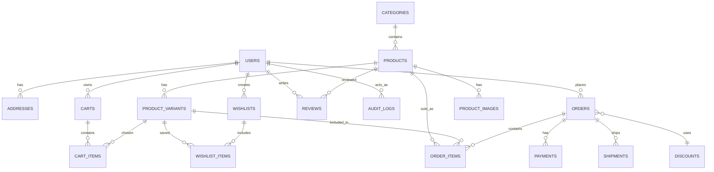

# Little Stars Kids Fashion Database Design

This project contains a MySQL 8+ / MariaDB schema for Little Stars Kids Fashion, a storefront for children’s clothing and accessories. The schema is implemented in [database/schema.sql](../database/schema.sql) and sample data is loaded using [database/seed.sql](../database/seed.sql).

## Database overview

- Database name: `little_stars_kids_fashion`
- Engine: InnoDB
- Character set: `utf8mb4`
- Currency: Nigerian Naira (`NGN`)
- Delivery and order flows: supported with snapshots so historical records remain accurate even if a customer later edits or removes an address.

## ERD



## Relationship explanations

- One user to many addresses: a customer can keep several saved delivery locations.
- One category to many products: each item belongs to exactly one category, while a category can have many products.
- One product to many product variants: each item can have different sizes and colors.
- One product to many product images: multiple visuals are supported for a single catalog item.
- One cart to many cart items: a cart stores one or more lines for specific variants.
- One user to many orders: a customer can place multiple orders over time.
- One order to many order items: each purchase is a collection of product snapshots.
- One order to many payments: payment retries or partial payments are supported with separate payment rows.
- One order to many shipments: an order can create more than one shipment record if delivery is split or retried.
- One user to many wishlist items and reviews: a customer can save favorite products and leave ratings.

## Normalization and data integrity

The design targets Third Normal Form (3NF) for the main operational tables.

- Product details, category data, and address data are stored separately to avoid duplicated or repeating groups.
- Product variants are modeled in their own table rather than storing size or color as comma-separated text.
- Order history is stabilized by copying the product and delivery details into order snapshots.
- Monetary totals are stored for order financial snapshots, which is justified because historical order values must remain stable even if current catalog pricing changes.
- No cascading deletion is used on orders, payments, shipments, or audit records in order to retain historical data.

## Constraints and business rules

- Emails must be unique for each user.
- SKUs are unique across all variants.
- Order numbers and payment references are unique.
- Monetary values use `DECIMAL` and are restricted to non-negative values.
- Stock quantities and variant prices are validated with `CHECK` constraints.
- Cart lines prevent duplicate variants inside the same cart.
- Ratings are restricted to 1 to 5.
- Product images use `is_primary` and ordering to control default display.
- Discounts include validation for value, dates, usage limit, and minimum order threshold.

## Common indexes

Indexes are created for the frequent lookups implied by the storefront workflow:

- `idx_products_category` for category browsing.
- `idx_variants_product` and `uq_variants_sku` for variant lookups by product and SKU.
- `idx_orders_user_date` for customer order history.
- `idx_payments_ref` for payment matching.
- `idx_cart_items_cart_variant` for cart line retrieval.
- `idx_shipments_tracking` for shipment tracing.

## Sample data and validation

The sample data in [database/seed.sql](../database/seed.sql) includes:

- Users and addresses
- Categories and products
- Product variants and images
- Cart and cart items
- Discounts and orders
- Order items, payments, and shipments
- Wishlist and reviews
- Audit log entries

To initialize the database locally with MariaDB / MySQL:

```bash
mysql -u root < database/schema.sql
mysql -u root little_stars_kids_fashion < database/seed.sql
```

Then validate the database with queries such as:

```sql
SELECT * FROM products;
SELECT * FROM product_variants WHERE product_id = 1;
SELECT * FROM orders WHERE user_id = 1;
SELECT * FROM payments;
```

## Notes on guest carts and coupon validation

- Guest carts are supported through the `session_id` column, while authenticated carts may be tied to a `user_id`.
- Coupon eligibility is checked in application code using the `discounts` table plus `discount_usage` records to prevent repeated use on the same order or beyond the configured limit.
- All customer-facing validation should be enforced in the PHP / PDO layer as a second line of defense.
